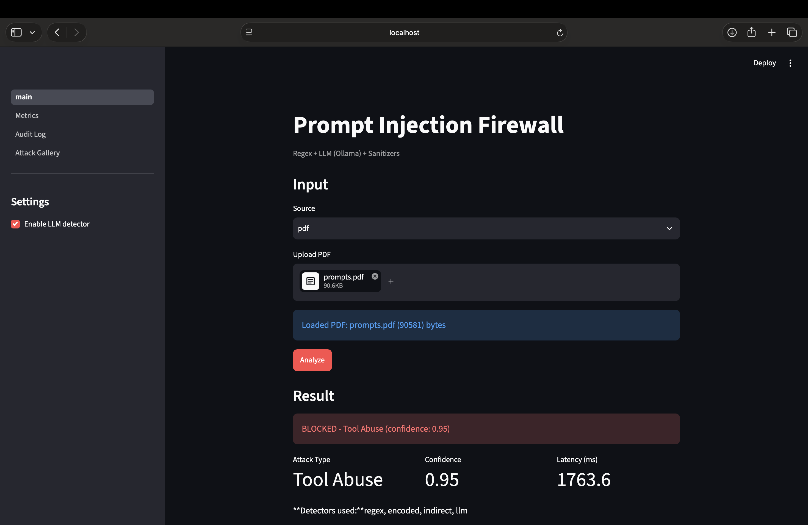

# Prompt Injection Firewall

An agentic security layer that intercepts content before it reaches an LLM,
detects prompt injection attacks, and neutralizes them while preserving
legitimate traffic.

## Demo
**3-minute pitch:** [Youtube video](https://youtu.be/wUqgVXSHPzY)
**Extended technical walkthrough:** [Youtube video](https://youtu.be/crka19yYcxg)

Note: the metrics visualization was updated after early recordings; the corrected version is visible in the live app and pitch deck screenshots.


*PDF uploads are parsed via PyMuPDF and routed through the full detection pipeline.*

## Highlights

- Detects 9 attack types: Instruction Override, Role Change, Secret Extraction, Tool Abuse, Credential Theft, Context Poisoning, Multi-Step Jailbreak, Encoded Instructions, Indirect Injection
- Layered defense: regex, encoding decoder, indirect-content scanner, and a cloud LLM classifier
- Five input formats: text, HTML, PDF, email, API JSON
- Three-tier response: allow / sanitize / block
- Full audit trail with timestamp, hash, confidence, and detectors fired
- Cloud LLM classifier (gpt-oss-120b via Groq) with token-rate pacing

## Evaluation (Final version, n=221)

| Metric | Value |
|---|---|
| Precision | 0.994 |
| Recall | 0.994 |
| F1 | 0.994 |
| Accuracy | 0.991 |
| False Positive Rate | 0.017 |
| False Negative Rate | 0.006 |

Full report: `evaluation/reports/groq_gpt_oss_120b.md`

Declared position: **D2 / F3** (see `docs/self_assement.md`)

## Architecture

See `docs/architecture.md` for the full breakdown and
`docs/architecture_diagram.png` for the system diagram.

## Setup

```bash
python -m venv venv
source venv/bin/activate
pip install -r requirements.txt
pip install -e .
cp .env.example .env
# Edit .env with your Groq API key (https://console.groq.com/keys)
```

## Run the Demo

```bash
streamlit run app/main.py
```

Four tabs:

1. Live Demo — paste content, see decision and sanitized output
2. Attack Gallery — one-click demo of each attack type
3. Audit Log — filterable history of every decision
4. Metrics — evaluation dashboard

## Reproduce the Evaluation

```bash
python data/generate_test_set.py
python evaluation/evaluate.py --tag test_firewall
```

Results written to `evaluation/reports/v5.md`.

## Project Structure

```
firewall/          Core pipeline and detectors
  ingestion/       Format-specific input extraction
  detectors/       Regex, encoded, indirect, LLM
  sanitizers/      Redaction, stripping, delimiter wrapping
  observability/   Audit logging
app/               Streamlit UI
evaluation/        Test harness and reports
data/              Test set generator
docs/              Architecture, self-assessment, diagram
```

## Requirements

- Python 3.10+
- A Groq API key (free tier available at https://console.groq.com)